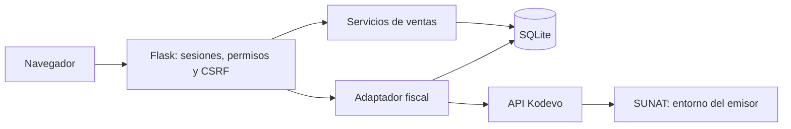

# Arquitectura

Factora es un monolito modular: interfaz y API se sirven desde Flask en el mismo origen. Reduce la configuración necesaria para ejecutar y estudiar el proyecto.

## Venta y stock

El servidor obtiene precios del catálogo y calcula importes. Una transacción comprueba existencias, registra venta y detalle, descuenta stock y crea movimientos. El navegador no determina el total definitivo. La clave de petición y el hash de contenido evitan repetir ventas por reintentos.

La venta guarda snapshots del cliente y negocio: modificar sus datos posteriormente no reescribe el documento interno original.

## Emisión externa

La emisión se solicita por separado desde una venta registrada. Antes de llamar al proveedor se guarda una solicitud local y se bloquea la anulación comercial. No se mantiene abierta una transacción SQL durante la llamada HTTP.

No existe una transacción distribuida entre SQLite y el proveedor. Por eso una respuesta perdida queda pendiente de verificación y no se reenvía automáticamente. La conciliación comprueba serie y referencia de venta antes de asociar un ID externo.

## Seguridad

- Cookies de sesión HTTP-only y SameSite; activar Secure cuando se sirve por HTTPS.
- Contraseñas derivadas con scrypt y tokens de sesión almacenados como hash.
- Validación de CSRF y origen en solicitudes que modifican datos.
- Permisos por rol y filtros por `company_id` en el servidor.
- Un emisor externo solo puede vincularse a un negocio local.
- Credenciales exclusivamente en el servidor; redirecciones HTTP externas deshabilitadas en el adaptador.

El aislamiento por negocio se implementa a nivel de aplicación. No equivale a bases independientes ni a Row Level Security.

## Evolución

Antes de escalar: medir concurrencia, paginar listados, añadir archivo fiscal durable, gestionar trabajos de emisión y conciliación en segundo plano y considerar PostgreSQL según la carga. Estas mejoras son trabajo pendiente, no capacidades de esta versión.
